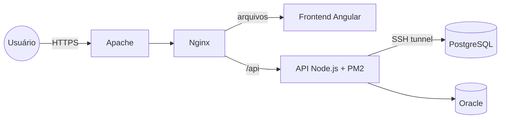

# Recicle Hub (demo pública)

Painel web para gestão de reciclagem corporativa: cadastro de recicladores, pesagens, saldo e relatórios de auditoria. Esta é a demo do sistema que roda em produção no Grupo Barcelos, com dados fictícios e sem backend.

Demo: https://lucaswotta.github.io/recicle-hub-public/


## Problema

O suporte e o contato diário com o cliente não tinham um sistema centralizado para administrar os dados, acompanhar a reciclagem e gerenciar a operação.

## O que o sistema faz

- Dashboard com gráficos D3.js (barras, pizza, linha) e ranking de recicladores, alimentado por uma única consulta consolidada com cache HTTP de 2 minutos.
- CRUD de clientes com filtros (busca, PF/PJ, status), paginação e máscara de telefone.
- 6 relatórios em Excel (saldo, resgates, clientes, transações, reciclagem, ranking), com proteção por senha.
- Perfis Admin, Support e Viewer, aplicados por guards de rota.
- Trilha de auditoria das alterações.

## Produção



| Camada | Tecnologia |
|---|---|
| Frontend | Angular 20 (standalone, signals, OnPush), TailwindCSS, D3.js |
| API | Node.js 18, Express, Zod, ExcelJS |
| Dados | PostgreSQL 16 (operação), Oracle (usuários e auditoria) |
| Autenticação | JWT com access token em memória (15 min) e refresh token em cookie HTTP-only (7 dias), rate limit de login |
| Operação | PM2, Nginx, Apache, deploy por script shell |

## Diferenças entre a demo e a produção

| | Demo | Produção |
|---|---|---|
| Dados | 50 clientes fictícios em memória | PostgreSQL e Oracle |
| Login | Simulado | JWT e bcrypt |
| Relatórios | Gerados no navegador | Gerados na API |
| Auditoria | Fictícia | Gravada no Oracle |

O diretório `backend/` está sanitizado e serve só de referência de arquitetura. A demo não o usa.

## Requisitos

Node.js 18 ou superior e npm 9 ou superior.

## Uso

```bash
git clone https://github.com/lucaswotta/recicle-hub-public.git
cd recicle-hub-public/frontend
npm install
npm run dev
```

Abra `http://localhost:4200`. Usuários de demonstração, todos com senha `123`:

| Usuário | Acesso |
|---|---|
| `admin` | Total |
| `support` | Sem saldo nem relatórios |
| `viewer` | Só visualização de relatórios |

## Estrutura

```
frontend/src/app/
  components/   home, clients, reports, settings, login, sidebar, toast
  services/     api (HTTP e mocks), auth, data, toast
  guards/       controle de acesso por perfil
  interceptors/ interceptors HTTP
  mocks/        dados fictícios
backend/        referência sanitizada: index.js, auth.js, db.js, routes/
```

## Limitações

- Sem persistência: recarregar a página restaura os dados fictícios.
- Sem testes automatizados.
- O backend não roda sem as variáveis de `backend/.env.example` e os bancos reais.

## Licença

MIT. Veja [LICENSE](LICENSE).

Autor: Lucas Motta, [GitHub](https://github.com/lucaswotta) e [LinkedIn](https://www.linkedin.com/in/lucaswotta).
