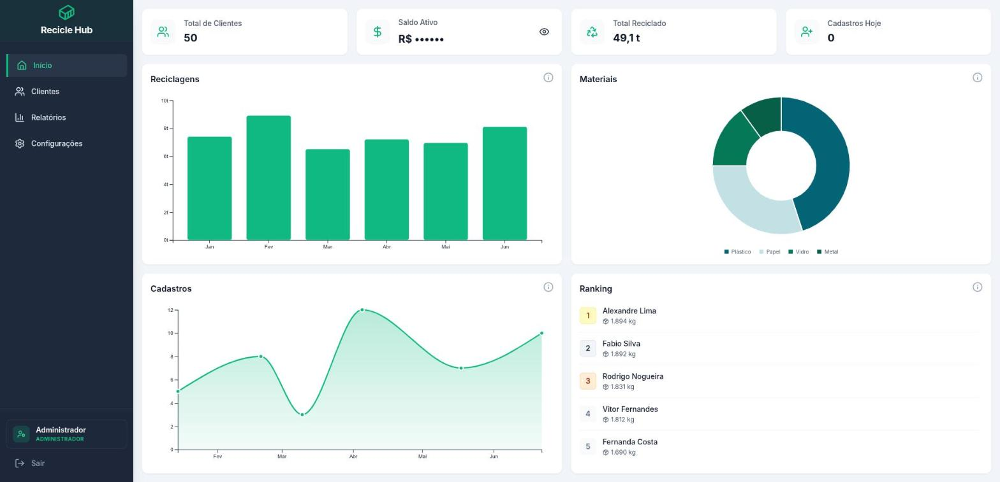
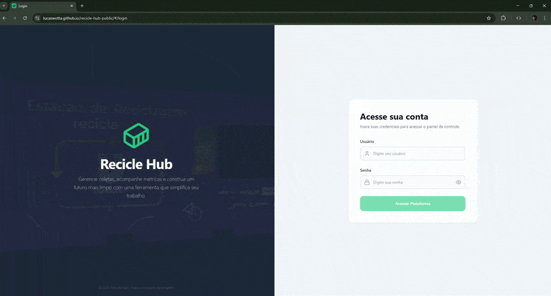
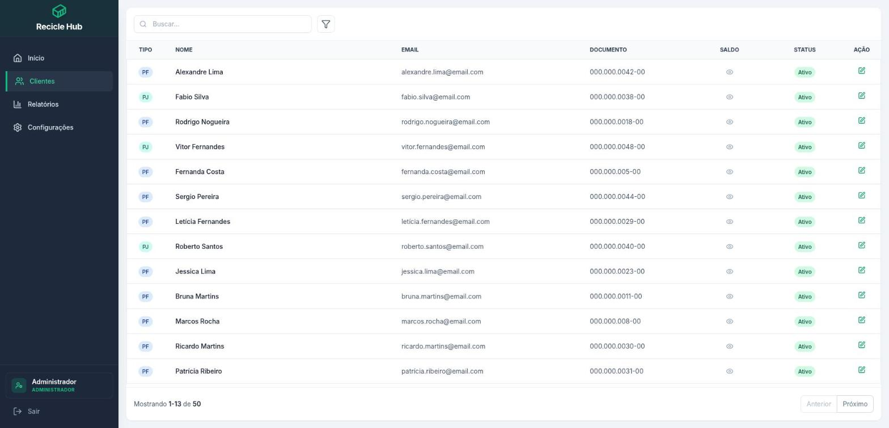
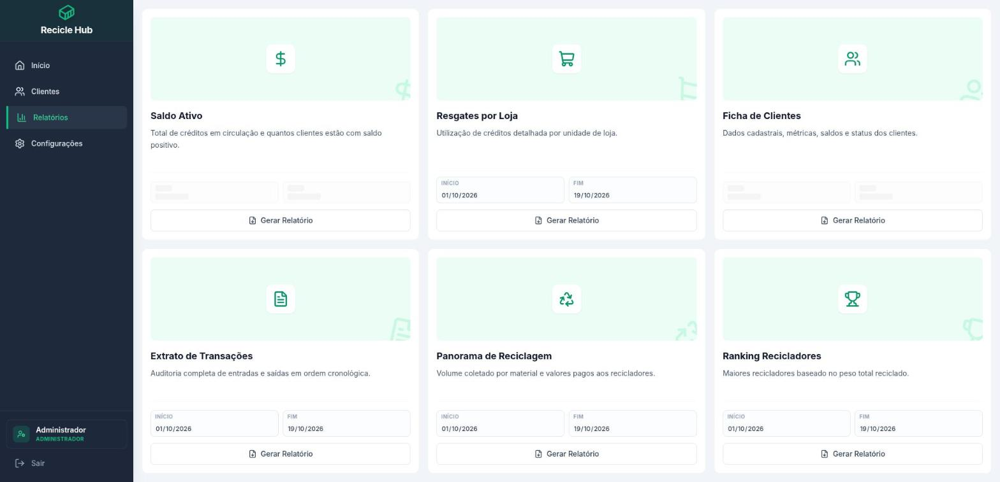
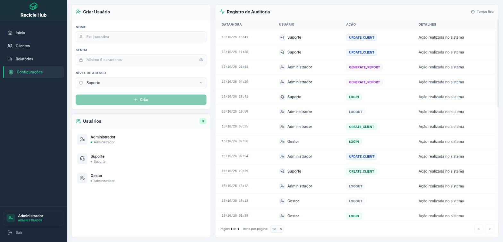
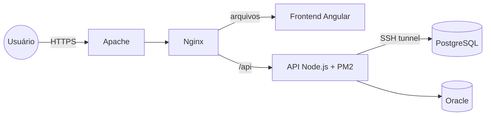

<div align="center">

# Recicle Hub

**Painel web para gestão de reciclagem corporativa: clientes, pesagens, saldo, relatórios e auditoria.**

Demo pública do sistema que roda em produção no Grupo Barcelos. Dados fictícios, sem backend.

[**Abrir a demo**](https://lucaswotta.github.io/recicle-hub-public/) ·
[Funcionalidades](#funcionalidades) ·
[Arquitetura](#arquitetura-em-produção) ·
[Rodar localmente](#rodar-localmente) ·
[Limitações](#limitações)

<br>



</div>

## Problema

O suporte e o contato diário com o cliente não tinham um sistema centralizado para administrar os dados, acompanhar a reciclagem e gerenciar a operação. O Recicle Hub reúne tudo em um painel: cadastro, saldo, relatórios para auditoria e histórico de quem fez o quê.

## Funcionalidades

| Área | O que tem |
|---|---|
| **Dashboard** | Indicadores (clientes, saldo, total reciclado, cadastros do dia), gráficos D3.js de reciclagem por mês, materiais e cadastros, ranking de recicladores. Uma consulta consolidada alimenta a tela, com cache HTTP de 2 minutos. |
| **Clientes** | Listagem paginada, busca, filtros (PF/PJ, status), edição, máscara de telefone, reset de senha com hash bcrypt. O saldo fica oculto até o usuário pedir. |
| **Relatórios** | 6 relatórios em Excel (saldo ativo, resgates por loja, ficha de clientes, extrato de transações, panorama de reciclagem, ranking), com filtro de datas e proteção por senha. |
| **Configurações** | Criação de usuários com nível de acesso e registro de auditoria (login, logout, criação e edição de cliente, geração de relatório). |
| **Acesso** | Três perfis, aplicados por guards de rota: Admin, Support (sem saldo nem relatórios) e Viewer (só relatórios). |

<div align="center">









</div>

## Arquitetura em produção



| Camada | Tecnologia |
|---|---|
| Frontend | Angular 20 (standalone, signals, OnPush), TailwindCSS, D3.js |
| API | Node.js 18, Express, Zod, ExcelJS |
| Dados | PostgreSQL 16 (operação), Oracle (usuários e auditoria) |
| Autenticação | JWT: access token em memória (15 min) e refresh token em cookie HTTP-only (7 dias); limite de tentativas no login |
| Operação | PM2, Nginx, Apache, deploy por script shell |

## Demo e produção

| | Demo | Produção |
|---|---|---|
| Dados | 50 clientes fictícios em memória | PostgreSQL e Oracle |
| Login | Simulado | JWT e bcrypt |
| Relatórios | Gerados no navegador | Gerados na API |
| Auditoria | Fictícia | Gravada no Oracle |

O diretório `backend/` está sanitizado e serve só de referência de arquitetura. A demo não o usa.

## Rodar localmente

**Requisitos:** Node.js 18 ou superior e npm 9 ou superior.

```bash
git clone https://github.com/lucaswotta/recicle-hub-public.git
cd recicle-hub-public/frontend
npm install
npm run dev
```

Abra `http://localhost:4200`. Usuários de demonstração, todos com senha `123`:

| Usuário | Acesso |
|---|---|
| `admin` | Total |
| `support` | Sem saldo nem relatórios |
| `viewer` | Só visualização de relatórios |

## Estrutura

```
frontend/src/app/
  components/    home, clients, reports, settings, login, sidebar, toast
  services/      api (HTTP e mocks), auth, data, toast
  guards/        controle de acesso por perfil
  interceptors/  interceptors HTTP
  mocks/         dados fictícios
backend/         referência sanitizada: index.js, auth.js, db.js, routes/
```

## Limitações

- Sem persistência: recarregar a página restaura os dados fictícios.
- Sem testes automatizados.
- O backend não roda sem as variáveis de `backend/.env.example` e os bancos reais.

## Licença

MIT. Veja [LICENSE](LICENSE).

Autor: Lucas Motta, [GitHub](https://github.com/lucaswotta) e [LinkedIn](https://www.linkedin.com/in/lucaswotta).
